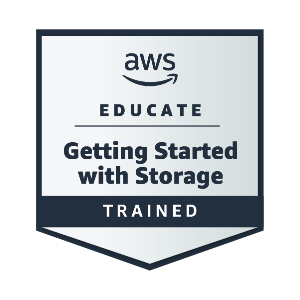
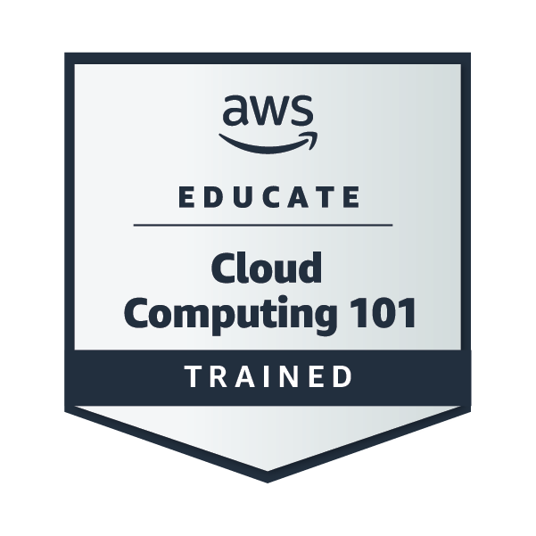
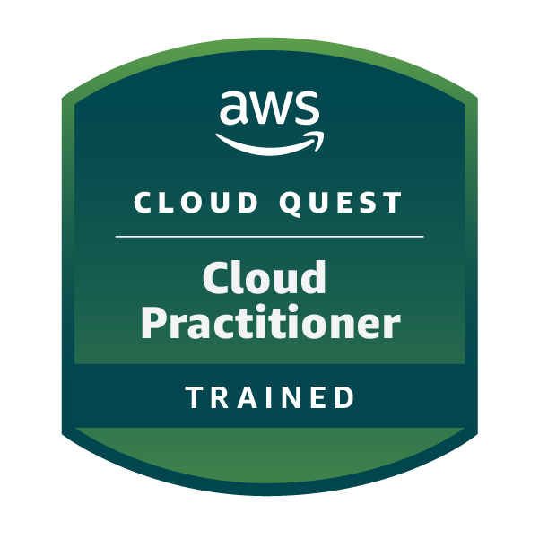

# 👋 Olá, sou José Airton!

Sou estudante de tecnologia com foco em **Cloud Computing, Engenharia de Software, AWS, Python, Linux, segurança e arquitetura de soluções**.

Atualmente participo da formação **AWS re/Start pela Escola da Nuvem**, desenvolvendo laboratórios práticos e documentando minha evolução técnica no GitHub.

## ☁️ Tecnologias e competências

### AWS

* Amazon EC2, Amazon S3 e Amazon EBS
* AWS Identity and Access Management (IAM)
* Princípio do menor privilégio
* Amazon VPC e AWS Network Firewall
* Regras stateful compatíveis com Suricata
* Amazon CloudWatch e Amazon SNS
* AWS Systems Manager
* AWS Pricing Calculator
* Otimização de custos e rightsizing
* Fundamentos do AWS Well-Architected Framework

### Engenharia de Software

* Levantamento e análise de requisitos
* Requisitos funcionais e não funcionais
* Regras de negócio e restrições
* Modelos de processo de desenvolvimento
* Documentação técnica
* Fundamentos de arquitetura de software
* Análise de decisões e trade-offs
* Versionamento de projetos com Git

### Desenvolvimento e ferramentas

* Python
* Linux e shell
* Git e GitHub
* Docker
* APIs REST
* Automação com n8n
* Fundamentos de segurança da informação

## 🧪 Projetos em destaque

### [AWS Cloud Labs Portfolio](https://github.com/AirtonNettu/aws-cloud-labs-portfolio)

Portfólio técnico com laboratórios práticos documentados, incluindo:

* controle de acesso com AWS IAM;
* aplicação do princípio do menor privilégio;
* inspeção de tráfego com AWS Network Firewall;
* regras stateful compatíveis com Suricata;
* monitoramento de CPU com Amazon CloudWatch;
* notificações orientadas a eventos com Amazon SNS;
* estimativa de custos com AWS Pricing Calculator;
* aplicação de rightsizing em instâncias Amazon EC2;
* documentação técnica, evidências, arquiteturas e trade-offs.

### SecurePass

Projeto de gerenciador de senhas desenvolvido com foco em segurança, arquitetura de software e proteção dos dados do usuário.

Conceitos aplicados:

* arquitetura Zero-Knowledge;
* Security by Design;
* princípio do menor privilégio;
* defesa em profundidade;
* separação de responsabilidades;
* documentação de decisões arquiteturais.

## 🎓 Formação e cursos

* **AWS re/Start — Escola da Nuvem**
  Formação em andamento com conteúdos de computação em nuvem, AWS, Linux, redes, segurança, bancos de dados e Python.

* **Nano Course Engenharia de Software — FIAP**
  Curso concluído, com carga horária de 100 horas e certificado de conclusão.

* **Fundamentos do Suporte Técnico — Google**
  Formação introdutória em suporte de TI, hardware, sistemas operacionais, redes e diagnóstico técnico.

## 🏅 Badges e participação AWS

  
  &nbsp;
  
  &nbsp;
  

  <strong>Badges de treinamento verificáveis emitidas pela AWS Training and Certification.</strong>

### AWS Educate Emerging Talent Community

  

  Membro da AWS Educate Emerging Talent Community.

## 📚 O que estou estudando

* AWS re/Start — Cloud, Linux, redes, segurança e Python
* AWS Well-Architected Framework
* Arquitetura de soluções na AWS
* Python — fundamentos, automação, scripts e Boto3
* Engenharia de Software — requisitos, processos e arquitetura
* Linux — terminal, permissões, processos e shell
* Redes — TCP/IP, CIDR, sub-redes, DNS e roteamento
* Segurança — IAM, defesa em profundidade e monitoramento

## 🎯 Objetivos

* Conquistar a certificação AWS Certified Cloud Practitioner
* Avançar para AWS Certified Solutions Architect – Associate
* Desenvolver projetos práticos com Python e serviços AWS
* Aprofundar conhecimentos em Engenharia e Arquitetura de Software
* Atuar profissionalmente com Cloud Computing, suporte técnico ou infraestrutura
* Evoluir em segurança e arquitetura de soluções em nuvem

## 🔗 Onde me encontrar

* [LinkedIn](https://www.linkedin.com/in/jose-airton-cloud)
* [Portfólio de laboratórios AWS](https://github.com/AirtonNettu/aws-cloud-labs-portfolio)

---

> “O futuro não é mais esperado — ele é construído.”
