  

# José Airton | Backend Python · AI Engineering · AWS

**Construindo aplicações, integrações e experiências de aprendizado com engenharia de software, cloud e inteligência artificial.**

Sou desenvolvedor em formação, com foco em **Backend Python e APIs**, integração de modelos de IA e serviços AWS. Transformo meus estudos em projetos documentados, explorando arquitetura, testes, segurança, automação e decisões técnicas.

Busco minha primeira oportunidade profissional em desenvolvimento Backend e sigo aprofundando minha atuação em **AI Application Engineering**.

[**Portfólio**](https://portfolio-airton-netto.pages.dev/) · [**LinkedIn**](https://www.linkedin.com/in/jose-airton-cloud) · [**Projetos no GitHub**](https://github.com/AirtonNettu?tab=repositories)

---

## 🚀 Projetos em destaque

<table>
<tr>
<td width="50%" valign="top">

### 🧠 [IA Engineer Academy](https://github.com/AirtonNettu/ai-engineering-academy-)

**Plataforma educacional open source em português.**

15 capítulos, 45 flashcards, quatro roadmaps e cinco diagramas interativos. Laboratórios no navegador para XOR, atenção e embeddings.

**Stack:** React · TypeScript · Vite · Vitest · Playwright

[🌐 Plataforma](https://ai-engineering-academy-3cy.pages.dev/) · [📖 Código](https://github.com/AirtonNettu/ai-engineering-academy-) · [🤝 Contribuir](https://github.com/AirtonNettu/ai-engineering-academy-/blob/main/CONTRIBUTING.md)

</td>
<td width="50%" valign="top">

### ☁️ [AWS Cost Monitor](https://github.com/AirtonNettu/aws-cost-monitor)

**FinOps com Python e interpretação assistida por IA.**

Projeto em evolução para coleta de custos com Boto3, análises determinísticas e relatórios interpretados por modelos de IA.

**Stack:** Python · AWS · Boto3 · FinOps · LLMs

[📖 Explorar repositório](https://github.com/AirtonNettu/aws-cost-monitor)

</td>
</tr>
<tr>
<td width="50%" valign="top">

### 🖥️ [Local-to-Cloud Diagnostic Gateway](https://github.com/AirtonNettu/Local-to-Cloud-Diagnostic-Gateway)

**Diagnóstico local e sincronização com a nuvem.**

Explora coleta offline, persistência, APIs e serviços AWS. Operação e dashboard seguem em evolução.

**Stack:** Python · Windows · SQLite · APIs · AWS

[📖 Explorar repositório](https://github.com/AirtonNettu/Local-to-Cloud-Diagnostic-Gateway)

</td>
<td width="50%" valign="top">

### ⚙️ [Reusable AI Backend Architecture](https://github.com/AirtonNettu/reusable-ai-backend-architecture)

**Infraestrutura reutilizável para aplicações de IA.**

AI Core e Gateway desacoplados, persistência PostgreSQL, segurança multilocatária e observabilidade. 159 testes aprovados no CI com PostgreSQL real.

**Stack:** Python 3.13 · FastAPI · PostgreSQL 17 · Docker · OpenTelemetry

[📖 Código e arquitetura](https://github.com/AirtonNettu/reusable-ai-backend-architecture) · [📘 Caderno técnico](https://github.com/AirtonNettu/reusable-ai-backend-architecture/blob/main/docs/caderno_tecnico.md)

</td>
</tr>
</table>

## 🧰 Stack e interesses técnicos

  
  
  
  
  
  
  

> 🎯 **Foco atual:** praticar Python, lógica de programação, funções e desenvolvimento Backend. IA aplicada e Cloud fazem parte da minha trajetória de aprendizado.

<strong>🔎 Ver tecnologias e práticas por área</strong>

| Área | Tecnologias e práticas |
| --- | --- |
| **Backend** | Python, FastAPI, APIs REST, HTTP, JSON, validação e testes |
| **Engenharia de IA** | LLMs, Ollama, tokens, embeddings, RAG, MCP, agentes e avaliação — em aprofundamento |
| **Cloud** | AWS, IAM, EC2, S3, Lambda, CloudWatch, redes e custos |
| **Frontend** | React, TypeScript, Vite e interfaces responsivas |
| **Qualidade e entrega** | Git, GitHub, CI/CD, GitHub Actions, Vitest, Playwright, documentação, requisitos e ADRs |
| **Infraestrutura e segurança** | Linux, Docker, redes, troubleshooting e fundamentos de AppSec |

Meu princípio de desenvolvimento: **usar IA para acelerar a implementação sem abrir mão da compreensão do código, dos testes e da revisão humana.**

## 🎓 Formação e aprendizado contínuo

- **AWS re/Start — Escola da Nuvem:** formação em andamento em cloud, Linux, redes, segurança, bancos de dados e Python.
- **AWS Certified Cloud Practitioner:** preparação em andamento; certificação ainda não obtida.
- **Desenvolvimento AI Native: Copilot, MCP, Agentes, Tasks e Skills — Rocketseat:** extensão concluída em outubro de 2026.
- **Nano Course Engenharia de Software — FIAP:** concluído em 2026.
- **Fundamentos de TI: Hardware e Software — Fundação Bradesco:** concluído em 2026.

### 🏅 Credenciais e atividades AWS

  
  &nbsp;
  
  &nbsp;
  

  
  &nbsp;
  
  &nbsp;
  

As três etiquetas da segunda linha são representações gráficas temporárias; ainda faltam os links individuais de verificação. Treinamentos e atividades não equivalem a certificações AWS obtidas por exame.

Membro da **AWS Educate Emerging Talent Community**.

---

## 🤝 Vamos conectar?

Tenho interesse em colaborar em projetos open-source, trocar experiências técnicas e conhecer oportunidades de desenvolvimento Backend e Engenharia de IA.

**[LinkedIn](https://www.linkedin.com/in/jose-airton-cloud)** · **[Portfólio](https://portfolio-airton-netto.pages.dev/)** · **[IA Engineer Academy](https://ai-engineering-academy-3cy.pages.dev/)**

*Aprendizado contínuo, software verificável e evolução técnica documentada.*
